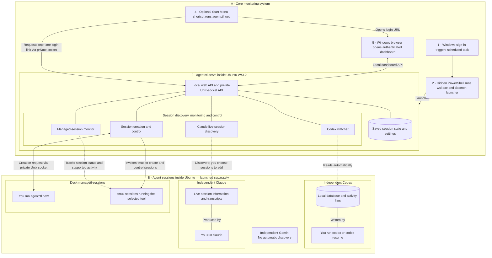

# Windows / WSL2 architecture

This describes the implementation on the `windows-wsl2` branch. Read A first:
the monitoring system starts at Windows sign-in. B describes agents launched
separately afterward, not additional boot steps. Boxes within the daemon are
logical responsibilities in one process, not separate services.

## Architecture



Numbers describe startup and dashboard opening only. Solid connections show
launch, control or API relationships; dashed connections show discovery and
monitoring. Agent groups are alternatives, not successive steps.

## Startup and readiness

With the normal PowerShell installation, Windows Task Scheduler runs a hidden
PowerShell process at user login. It starts the selected WSL distribution and
runs the daemon launcher. The launcher runs `agentctl serve` and writes its log
inside WSL. Systemd is not required.

The daemon loads its state, serves local APIs and starts its configured watchers.
It can monitor with no browser open and no active agents. The Start Menu
shortcut runs `agentctl web`, obtains a fresh one-time login link and opens the
Windows browser. Opening the dashboard does not launch agents.

The default restore mode is `ask`: lost managed sessions require an explicit
restore. If `agentctl set restore auto` is enabled, the daemon can automatically
restore eligible saved managed sessions. Therefore startup does not always
mean that no agents will be restarted.

## How sessions enter the deck

| Session | Discovery or creation | Monitoring |
| --- | --- | --- |
| Independently started Codex | Dedicated watcher reads Codex's local database and rollout files; recent threads appear automatically | Read-only; interact in the original terminal |
| Independently started Claude | Dedicated live-session discovery finds candidates; add one through **+ session** or `agentctl live` followed by `agentctl add <session>` | Watches added sessions; answer, interrupt or stop them in their own terminal |
| Independently started Gemini | No automatic discovery | Not monitored through this path |
| Agent started with `agentctl new` | Daemon creates a tmux session and launches the selected command | Claude has hook/transcript-based monitoring; managed Codex and Gemini have basic running/exited tracking |

The Codex watcher polls every two seconds and defaults to threads active within
the last six hours. It must be enabled, and its data directory must exist when
the watcher starts. If Codex is first installed or initialized after daemon
startup, restart the daemon so that watcher can start.

This version has no universal process-discovery service for arbitrary agent
CLIs. Discovery uses the implemented tool-specific paths. The Windows setup
covers sessions accessible to the daemon's Linux user in the selected WSL
distribution, not native Windows sessions or arbitrary other distributions.

## Starting a managed session

Run these commands inside Ubuntu, in the project directory:

```sh
agentctl new             # Claude by default
agentctl new -c codex
agentctl new -c gemini
agentctl new -c shell
```

The selected tool must already be installed and available in WSL. You initiate
the request; the daemon handles tmux session creation. tmux itself is an
installed dependency, not something the daemon installs at startup.

Focus for managed sessions opens a Windows Terminal tab attached to the tmux
session. Independently discovered Codex sessions use their original terminal.

## Implementation references

- [Windows installer](../install.ps1): login task, launcher and Start Menu shortcut.
- [CLI and daemon startup](../backend/cmd/agentctl/main.go): `new` command and watcher startup.
- [Daemon](../backend/internal/daemon/daemon.go): managed-session creation and monitoring.
- [Codex watcher](../backend/internal/daemon/codexwatch.go): discovery polling and session updates.
- [Claude live discovery](../backend/internal/daemon/live.go): discovery and explicitly added sessions.
- [Restore behavior](../backend/internal/daemon/restore.go): lost sessions and automatic restore.
- [Windows setup guide](windows.md): installation, startup and troubleshooting.

This document describes code behavior, not a claim that every path has passed
runtime validation. Windows installation, dashboard display and managed-session
Focus have been manually exercised; the branch's initial CI run failed.
